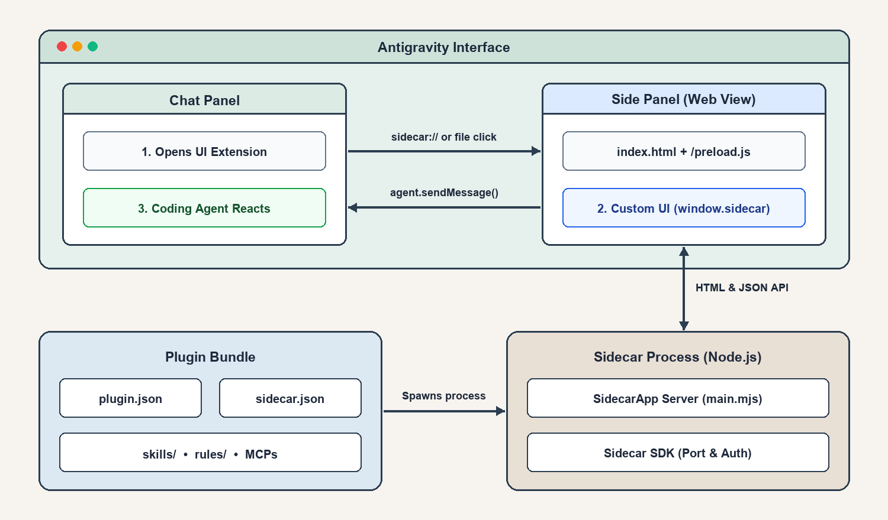
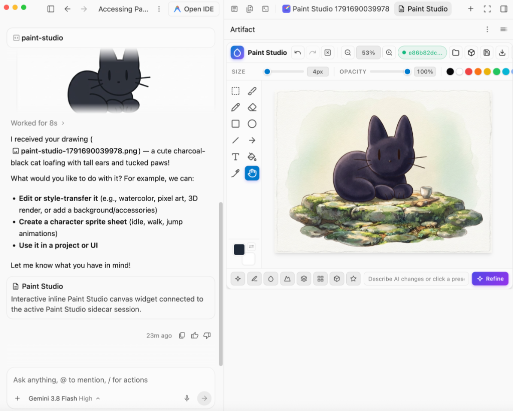
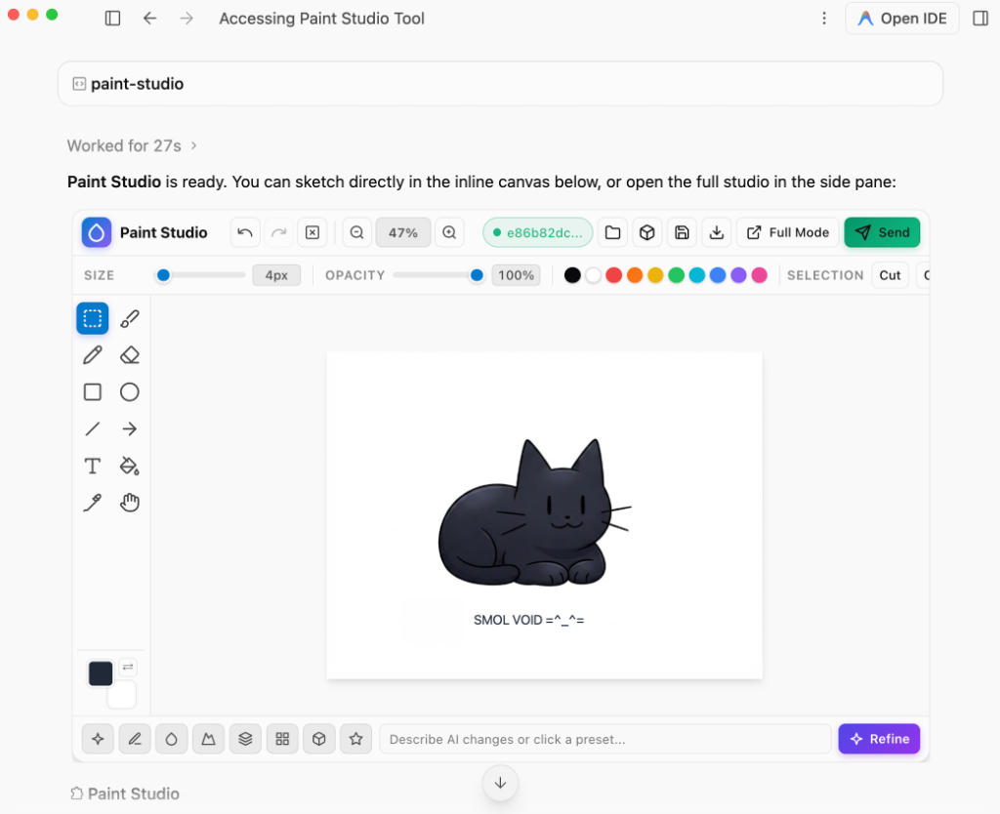
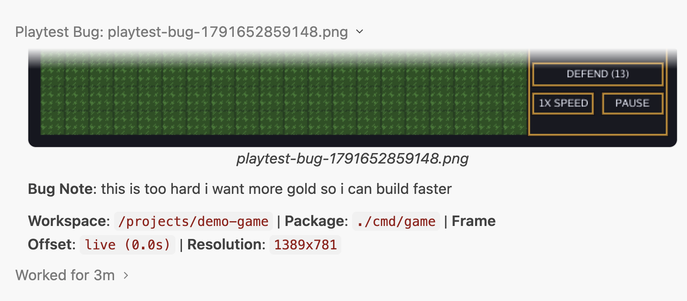

普段のブログ記事ではかなり地に足のついたトーンで書くことが多い私ですが、今回ばかりは*本当に*ワクワクしています。先週、Antigravityチームがリリースした [Antigravity 2.22.0](https://antigravity.google/releases?tab=hub&version=2.22.0) に、私の度肝を抜く新機能が含まれていたからです。それが、Antigravityプラグインにおける **UI Extensions** のサポートです。なぜこれが重要なのでしょうか？コーディングエージェントを使った開発体験（DX）そのものを根本からより良いものへと変えてしまうからです。さっそく見ていきましょう。

UI Extensionsを使うと、Antigravityのサイドパネル内にカスタムユーザーインターフェースを描画できます。これが素晴らしい最大の理由は、画像編集、ソフトウェアテスト、ログマイニング、データ分析といった、これまでなら別々の外部アプリを立ち上げる必要があった機能をオンボードで取り込み、Antigravityのインターフェースを自在に拡張できるようになることです。

たとえば、次のアプリのUIを設計している場面を想像してみてください。これをテキストだけで説明するのは、たいていひどい体験になります。絵を描けばテキストよりもはるかに正確に意図を伝えられますし、マルチモーダルであるGeminiなら描いた図をそのまま理解してくれます。UI Extensionsが登場する前は、[Excalidraw](https://excalidraw.com/) のような画像エディタや作図ツールを立ち上げてスケッチを描き、それをコピー＆ペーストしてプロンプトに貼り付けていました。それ自体が最悪というわけではないものの、少し面倒な作業でした。しかしUI Extensionsがあれば、AntigravityのUI内に本格的な作図ツールを常駐させ、ボタンを1回クリックするだけで注釈付きの画像をコーディングエージェントのセッションへ送り、即座に反応してもらうことができます。

これは氷山の一角にすぎません。Antigravityから一歩も出ることなく、その場で画像やログ、あらゆる補助データを添えて作業内容に注釈をつけ、視覚的に問題を説明できること——これこそが、ついに「未来に生きている」と私に確信させた理由です。

それを証明するために、今すぐ試せるUI Extensions搭載のオープンソースプラグインを2つ作成しました。マルチレイヤー描画・編集・AI画像リファインメントに対応する [**Antigravity Paint Studio (`agy-paint-studio`)**](https://github.com/danicat/agy-paint-studio) と、Go言語で2Dゲームを構築し視覚的にデバッグするための [**Antigravity Game Studio (`agy-game-studio`)**](https://github.com/danicat/agy-game-studio) です。

これらが裏側でどのように動いているのか見ていきましょう。

## UI extensionの構造

UI extensionとは、インタラクティブなWebパネルを公開し、Antigravityインターフェース内に描画できる [**sidecar（サイドカー）**](https://antigravity.google/docs/sidecars/) を含んだプラグインのことです。通常のプラグインと同様に、スキル（Skills）やMCP、ルール（Rules）を同梱できるため、特定のドメイン（たとえば画像編集など）を中心とした完結した体験を構築できます。

プラグインはワークスペース単位（`.agents/plugins`）またはグローバル単位（`~/.gemini/config/plugins`）のどちらにもインストール可能です。スキルと同様に、所定のディレクトリ構造に従う必要があります。

```text
plugins/<plugin-name>/
├── plugin.json             # 必須のマーカー兼マニフェストファイル
├── mcp_config.json         # MCPサーバー定義（任意）
├── hooks.json              # フック定義（任意）
├── skills/                 # スキル用ディレクトリ（任意）
│   └── <skill-name>/
│       └── SKILL.md
├── agents/                 # サブエージェント定義テンプレート（任意）
│   └── <agent-name>.md
├── rules/                  # ルール用ディレクトリ（任意）
│   └── <rule-name>.md
└── sidecars/
    └── <sidecar-name>/
        └── sidecar.json    # UI extensionsに必須
```

通常のサイドカーはどのプログラミング言語でも構築できますが、UI extensionsでは [Node.js](https://nodejs.org/) を活用します。Antigravityにはエージェントのメインプロセスとサイドカープロセス間の通信を簡略化する **Sidecar SDK** が同梱されており、ポートの自動検出やメッセージングといった処理はすべてSDKが自動的に引き受けてくれるためです。

余談ですが、[Devoxx Belgiumでの「State of Agentic Coding」セッション](https://www.youtube.com/watch?v=nHRSwiFNQ9E) で実演したように、Node.jsやSidecar SDK、UI Extensionsのサポートを一切使わずに同じ体験を実現すること自体は可能です。ただ、自前で実装するアプローチの問題は、ポート割り当て（および競合の回避）やセッションの検出・通信をすべて泥臭く処理しなければならない点にあります。Sidecar SDKを使えば、そうした面倒が一気に解消されます。



エントリーポイントは `sidecars/<sidecar-name>/sidecar.json` です。このファイルで、バックグラウンドプロセスの起動方法とWeb UIをサイドパネルに描画する方法をAntigravityに伝えます。

```json
{
  "command": "node",
  "args": ["main.mjs"],
  "restart_policy": "always",
  "display_name": "My Extension",
  "has_web_ui": true,
  "ui_config": {
    "views": [
      {
        "path": "/",
        "entrypoint": "SIDECAR_UI_ENTRYPOINT_AUX_PANE",
        "title": "My Extension"
      }
    ]
  }
}
```

ここで注目すべきは `has_web_ui` 属性と `ui_config` プロパティです。この2つが、通常のサイドカーをUI extensionへと変える鍵になります。

`"command": "node"` はAntigravity同梱のNode.jsランタイムと `sidecar_sdk` を使用するため、`npm install` も `node_modules` も一切不要です。`main.mjs` のバックエンド実装は、わずか数行のJavaScriptで完結します。

```javascript
import { readFileSync } from 'node:fs';
import { SidecarApp } from 'sidecar_sdk';

const app = new SidecarApp();

// Re-reading on each request lets edits appear when you reopen.
app.page('/', () =>
  readFileSync(new URL('./index.html', import.meta.url), 'utf8')
);

// POST routes return JSON and verify the sidecar token automatically.
app.api('/api/save', (data) => ({ saved: true, name: data.name }));

app.run();
```

フロントエンド側では、HTMLの `<head>` に `<script src="/preload.js"></script>` を追加するだけで、Antigravityのライト／ダークテーマ変数が同期され、`window.sidecar` が公開されます。これにより、UIからバックエンドの呼び出し（`fetch()`）、開いているワークスペースの取得（`getWorkspaceUris()`）、そしてアクティブなチャットターンへの直接メッセージ送信（`agent.sendMessage()`）が可能になります。有効化すると、右上の **⋮** メニューの **Extensions** から開いたり、`file_extensions` に一致するファイルをクリックしたり、チャット内の `sidecar://` ピルをクリックしてパネルを開いたりできます。

## 自分のUI extensionsを簡単に作る方法

こうした実装の詳細を知っておくのはいざという時に役立ちますが、正直なところ、皆さんがこれらの拡張機能を手書きしなくて済むことを願っています。というのも、Antigravityは「自己認識（self-aware）」を持っており、UI extensionsの作り方を自分自身で理解しているため、ただ作ってと頼むだけでいいからです。明示的に指示したい場合は、`/plugin` スキルや `/ui-extension` スキルを呼び出すよう頼むことができます。また、カスタマイズ全般について「教え込みたい」場合は `/agy-customizations` スキルも使えます。

「Antigravity Paint Studio」も「Antigravity Game Studio」も、まさにこの方法で構築しました。それでは、両方の拡張機能を見ていきましょう。

## Paint StudioでAntigravityから出ずに画像を編集する

**Paint Studio** は、冒頭で触れたユースケースそのものから生まれました。「百聞は一見に如かず」と言うように、コンテキストスイッチなしで、画像を使って自分の抱えている問題をエージェントに説明したかったのです。つまり、Antigravityの中でゼロから素早くアイデアをスケッチしたり、ワークスペースやチャットセッション内の画像をクリックしてサイドパネルで開き、その上にメモを書き込んでエージェントに送り返せる場所が必要でした。



この構成が本当に楽しいのは、ワークフローの **両側にAIがいる** 状態になることです。左側のチャットパネルにはコーディングエージェントがおり、右側のPaint Studio内部にもGemini（この場合はNano Banana 2 Lite、別名 `gemini-3.1-flash-lite-image`）が直接組み込まれています。上のスクリーンショットでは、あの小さな黒猫「smol void」を10秒ほどで描いた後、数回のリファインメントステップを経て、Nano Banana 2 Liteがサイドパネルに表示されている水彩画へと仕上げてくれました。

また、Paint StudioではAntigravityのもうひとつの興味深いUI機能である **Generative UI（生成UI）** も活用しています（実際、[Paint Studioの最初のプロトタイプ](https://x.com/danicat83/status/2100298197931372652) は `/generative_ui` だけで作ったものでした）。Generative UIがUI Extensionsと異なるのは、チャットウィンドウ内にインラインで描画される点です。スキル `/generative_ui` によって起動され、Paint Studioのような再利用可能なサーフェスを作る用途にも、1回限りのデータ可視化のような使い捨てのサーフェスを作る用途にも使えます。



Generative UIは、高さ最大500pxのサンドボックス化されたiframeを描画する `<agent-embed>` ブロックを発行することで動作します。このiframe内には、インラインJavaScriptとホストが提供するセマンティックなTailwindクラス（`bg-[var(--card)]` や `text-[var(--foreground)]` など）を使って **ほぼ** 何でも配置できます。ただし、コンテンツセキュリティポリシー（CSP）によって外部CDNはAntigravity同梱のTailwindスクリプト（`https://www.gstatic.com/antigravity/web/dev/tailwindcss.min.js`）を除いてすべてブロックされており、WebAssembly（WASM）を実行することもできません。

Paint Studioでは、フルUI（サイドパネルやポップアウト表示用）とシンプルUI（`/generative_ui` によるインラインパネル用）のどちらも描画できる専用エンドポイントを用意しています。さらにプラグインには `/paint-studio` スキルを同梱してあるため、ちょっとした図が必要になったときにすぐスタジオを開ける便利なショートカットとして使えます。



さらに便利な機能として、`sidecar.json` に拡張機能で開くファイル形式（`*.psd` や `*.png` など）を登録しておくこともできますし、Extensionsメニューから白紙のキャンバスとしてアプリを起動することも可能です。

```json
{
  "ui_config": {
    "display_name": "Paint Studio",
    "views": [
      {
        "path": "/",
        "entrypoint": "SIDECAR_UI_ENTRYPOINT_AUX_PANE",
        "title": "Paint Studio",
        "file_extensions": [".psd", ".png", ".jpg", ".jpeg", ".webp"]
      }
    ]
  }
}
```

これにより、完全な双方向コミュニケーションが確立されます。任意のファイルをクリックしてスタジオで開き、注釈やレタッチ、AIによる改善を加えて、ボタン1つでチャットへ送信できるのです。

## Antigravity Game Studioで2Dゲームをテストプレイ＆デバッグする

ゲーム開発用のスキルを作って以来、これをどうすれば次のレベルへ引き上げられるかずっと考えていました。スキルは基本的にプロンプトなので、それだけで到達できる範囲には限界があります。ゲーム開発には、アートディレクション、アセット制作、レベルデザイン、HUDなど、視覚的な要素が非常に大きく関わってくるからです。

Paint Studioで新しい体験を探求した後、ゲーム開発者向けの開発体験も同じように再設計できないかと考え始め、そこで生まれたのが **Antigravity Game Studio** です。最初はあらゆるツールを詰め込もうとしたのですが、収拾のつかない巨大な塊になってしまいました。そこで、視覚的な入力から最も恩恵を受けられるたった1つの機能に絞り込むことにしました。それが **テストプレイ（playtesting）** です。

UI extensionである **Playtest Studio** が行うことはただ1つ。Goで書かれたゲームをWebAssemblyにコンパイルし、サイドパネル内でそのまま60 FPSでライブプレイ＆デバッグできるようにすることです。プレイ中、Playtest Studioは（DVRのように）直近 **10秒間のリプレイバッファ** を常時記録しています。


ゲーム内で何かおかしな挙動を見つけても、デバッグのループはわずか数秒で完結します。

1. `F8`（または `` ` ``）キーを押して **一時停止（Pause）** し、10秒間のタイムラインをコマ送りで巻き戻してバグが発生した決定的瞬間を捉えます。
2. 問題のあるスプライトの上に直接ボックスや矢印を描き込むか、画面周囲の余白に短いメモを書きます。
3. **📸 Frame** または **🎞️ 10s GIF** をクリックし、注釈付きのスクリーンショット（または10秒間のアニメーションGIFリプレイ）を、キャプチャされたWebAssemblyのコンソールログと一緒にチャットセッションへ直接送り、エージェントに修正してもらいます。

スタジオはこれらすべての情報を構造化されたメッセージとしてエージェントに送り返すため、テキストだけのプロンプトよりもはるかに曖昧さの少ない状態で、即座に修正作業に取りかかることができます。



以下の動画では、このワークフロー全体の実際の動きをご覧いただけます。エージェントが作り終えたばかりの2Dタワーディフェンスゲームを初めてPlaytest Studioで開き、視覚的なフィードバックと10秒間のGIFをチャットに送って、その場でゲームの経済バランスを調整しています。



## まとめ

エージェントのすぐ隣に常駐し、ワンクリックで対話できるカスタムビジュアルツールを自作できる機能は、コーディングワークスペースのあり方を根本から変えてしまいます。外部アプリへのコンテキストスイッチやスクリーンショットのコピー＆ペーストを繰り返す代わりに、今取り組んでいる課題に合わせてAntigravityのインターフェースそのものを自在に形作ることができるのです。

これらのプラグインを実際に試してみたい方や、Antigravityに自分専用のUI extensionsを作らせるインスピレーションとして活用したい方は、ぜひGitHubリポジトリをチェックしてみてください。[**`danicat/agy-paint-studio`**](https://github.com/danicat/agy-paint-studio) と [**`danicat/agy-game-studio`**](https://github.com/danicat/agy-game-studio) の両方を公開しています。

それでは、楽しいスケッチを！
