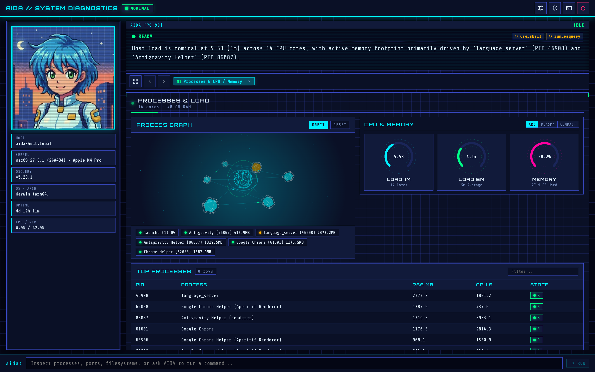
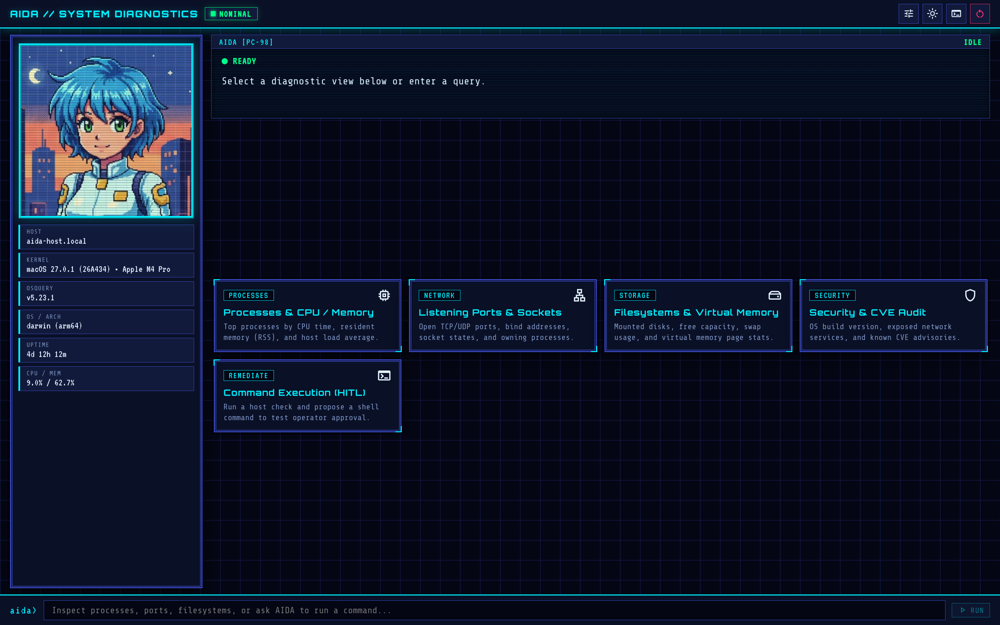
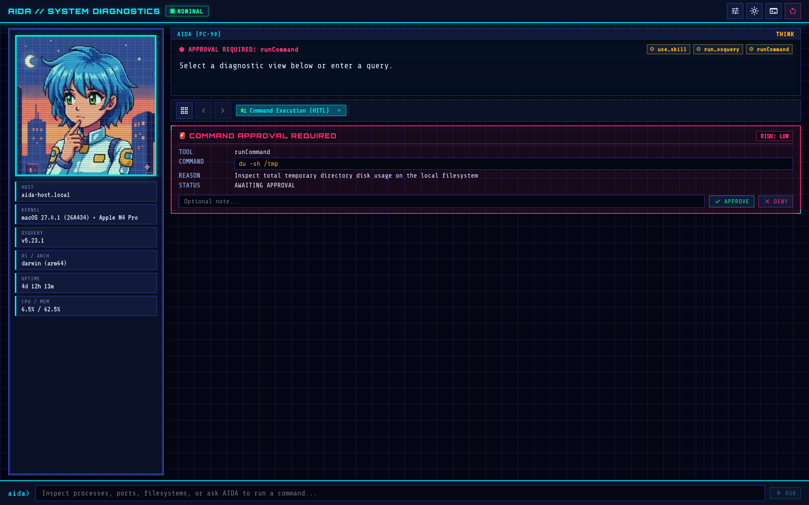
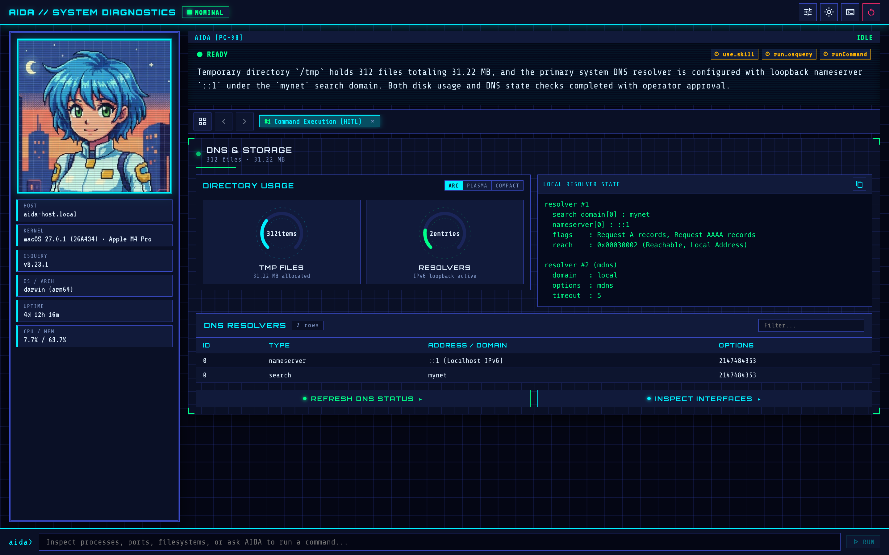

No [artigo anterior](), reconstruímos o backend da AIDA, a Agente de Diagnóstico por IA, substituindo sua configuração legada de RAG em Python e SQLite por um binário compilado em Genkit Go e Agent Skills sob demanda.

Com o backend concluído, nossa atenção se volta para o frontend. Mesmo com um novo cérebro em Go e skills sob demanda, a AIDA ainda é praticamente um chatbot: você digita um prompt, ela executa o `osquery` e despeja uma parede de texto de volta para você. Embora a AIDA tenha uma temática retrô, não precisamos limitá-la a uma experiência tão ultrapassada.

Interfaces agênticas modernas não devem apenas fazer uso de elementos de interface mais ricos, mas também se adaptar às necessidades do usuário em vez de aplicar uma abordagem estática de tamanho único.

Neste artigo, modernizamos a interface da AIDA. Antes de nos aprofundarmos no código, vamos analisar o que uma UI agêntica moderna exige e como funciona o protocolo [Agent to User Interface (A2UI)](https://a2ui.org/).

## O que é o A2UI?

O A2UI é um protocolo aberto do Google que permite que agentes de IA se comuniquem diretamente usando componentes nativos de interface do usuário. Em vez de limitar as respostas a texto, um agente pode montar dinamicamente painéis, gráficos, tabelas e controles interativos adaptados a qualquer tarefa que você esteja realizando no momento.

Seu frontend mantém total controle sobre o estilo visual e a renderização da interface, enquanto o agente escolhe *o que* exibir com base no contexto da conversa e nos dados.

Uma integração com A2UI gira em torno de três conceitos principais:

- **Catálogo (Catalog)**: O menu compartilhado de blocos de construção de UI (como painéis, medidores, gráficos, tabelas e botões) e seus esquemas. Tanto o agente no backend quanto o cliente no frontend concordam previamente com o catálogo — você pode usar o catálogo básico embutido ou definir componentes customizados sob medida para o seu domínio.
- **Superfícies (Surfaces)**: O canvas dinâmico de interface (`<a2ui-surface>`) renderizado no cliente. Conforme o agente trabalha, ele transmite mensagens estruturadas em JSON (`application/a2ui+json`) indicando ao cliente quais componentes do catálogo posicionar na superfície e como atualizar suas propriedades em tempo real.
- **Ações (Actions)**: Eventos bidirecionais enviados de uma superfície de volta ao agente quando o usuário interage com um componente — como clicar em um botão, selecionar uma linha em uma tabela ou inspecionar um nó em um grafo. As ações transformam cliques diretamente no próximo turno da conversa, sem a necessidade de digitar um prompt de acompanhamento.

## A nova especificação de frontend da AIDA

Queremos migrar de uma interface hardcoded para algo que o agente possa definir livremente conforme o contexto, utilizando o A2UI. Isso exige definirmos um catálogo de componentes para a AIDA e conceder a ela acesso a esses blocos de construção. Também precisamos reestruturar o frontend para que ele consiga renderizar adequadamente as superfícies A2UI.

Aqui está o novo cockpit de diagnóstico em ação. Em tempo de execução, a AIDA monta um grafo de processos em 3D, medidores estilo heads-up display (HUD) e uma tabela dinâmica de processos do `osquery`:



O prompt a seguir traduz essa intenção em uma especificação:

```markdown
Upgrade AIDA's web interface from a static chat UI to a generative diagnostic cockpit using A2UI and Genkit.

Requirements:
1. Keep the retro NEC PC-98 cyberpunk look and feel (AIDA's pixel avatar, CRT scanlines, and neon palette), with a fixed host-status sidebar showing live osquery system vitals.
2. Replace the plain Markdown chat output with an A2UI surface powered by a custom "aida" component catalog for system diagnostics: HUD panels, gauges, charts, filterable data tables, 3D system visualisations, text blocks, and action buttons.
3. Wire up two-way A2UI actions so clicking a table row, 3D node, or button sends a follow-up diagnostic action back to AIDA.
4. Add a human-in-the-loop shell command tool so AIDA can actually fix issues she finds on the host, pausing for explicit Approve/Deny confirmation in the UI before executing any command.
/grill-me
```

Não espere acertar tudo de primeira apenas com esse prompt. Na verdade, é fundamental fornecer ao seu agente de programação as skills, MCPs e ferramentas adequadas para a tarefa, como veremos na seção "Skills recomendadas" a seguir.

Você também pode notar a dica da skill `/grill-me` no final do prompt. Essa skill vem embutida no Antigravity (e na maioria dos agentes de codificação modernos), e ativá-la instrui o agente a fazer perguntas sempre que as instruções forem ambíguas ou faltarem detalhes. Isso ajuda a refinar sua visão e tira a pressão de ter que escrever um prompt impecável desde o início.

Como o prompt acima é bastante conciso, a skill `/grill-me` assume boa parte do trabalho pesado. É por isso que podemos nos dar ao luxo de não especificar completamente o catálogo de componentes (como veremos abaixo): o Antigravity nos fará perguntas para preencher as lacunas do prompt.

### Skills recomendadas

Como estamos trabalhando com Genkit, recomendo que você instale e ative as [Genkit Skills](https://github.com/genkit-ai/skills) oficiais, incluindo `developing-genkit-go` e `developing-genkit-js`. Essas skills contêm não apenas o conhecimento de como construir agentes e fluxos, mas também de como trabalhar com os elementos do A2UI tanto no lado do cliente quanto no do servidor.

Além dessas, a skill `gemini-api-dev` ajuda o agente a utilizar modelos modernos em vez de recorrer a versões defasadas. Essa skill pode ser instalada isoladamente a partir do repositório [Google Skills](https://github.com/google-gemini/gemini-skills/blob/main/skills/gemini-api-dev/SKILL.md) ou como parte do [Gemini Cloud Developer Plugin](https://cloud.google.com/blog/topics/developers-practitioners/introducing-the-google-cloud-developer-plugin-for-ai-coding-agents).

## Design do catálogo A2UI

O desenvolvimento frontend tradicional envolve projetar a interface do usuário em torno das jornadas de usuário que desejamos atender. Isso não é diferente em aplicações A2UI, mas aqui não desenharemos telas de aplicação clássicas e estáticas. Em vez disso, vamos nos concentrar em projetar os componentes individuais necessários para alcançar nossos objetivos.

Esses componentes compõem o **catálogo** do agente e dão a ele a flexibilidade necessária para adaptar a UI sob demanda. Você não **precisa** necessariamente criar um catálogo do zero, pois o A2UI já vem com um **Catálogo Básico** que atende à maioria das necessidades comuns. Mas como nosso objetivo aqui era criar uma experiência única, projetar um catálogo customizado foi a melhor escolha para a AIDA.

Estes são os sete componentes que desenhamos para a AIDA:

- **Panel**: Um contêiner HUD moldurado que agrupa componentes relacionados em linhas, colunas ou grades, com um badge de status (`nominal`, `warning` ou `critical`) para identificar subsistemas com problemas rapidamente.
- **Scene3D**: Um canvas interativo com wireframe em 3D para visualizar topologias de sistema — como árvores de processos, núcleos de CPU, matrizes de memória, malhas de rede, setores de disco ou zonas térmicas — com nós clicáveis para inspeção detalhada.
- **CyberChart**: Um gráfico com múltiplas séries (linhas, barras, áreas, dispersão ou radar) para plotar métricas como uso de CPU, throughput de rede e latência.
- **HudGauge**: Um medidor visual (arco circular, barra de plasma ou barra segmentada) para métricas de capacidade e porcentagem, como uso de disco, carga da bateria e pressão de swap.
- **DataMatrix**: Uma tabela com suporte a ordenação e filtros para resultados do `osquery`, onde clicar em qualquer linha dispara uma inspeção subsequente naquele item.
- **TextBlock**: Uma nota de diagnóstico monoespaçada para resumos, saídas de comandos e trechos copiáveis de código.
- **ActionButton**: Um botão interativo que permite à AIDA sugerir ações corretivas em um clique, como inspecionar um processo suspeito ou executar uma correção.

Projetar instrumentos específicos de domínio como esses faz uma enorme diferença, já que o catálogo básico foca principalmente na funcionalidade em detrimento da estética e de experiências mais ricas para o usuário.

## Configurando o A2UI no backend em Go

Para dar à AIDA acesso aos nossos novos blocos de construção de UI no backend, habilitamos o plugin A2UI do Genkit na inicialização e carregamos nosso catálogo personalizado de componentes junto com as ferramentas de diagnóstico dela:

```go
// internal/agent/agent.go
g := genkit.Init(ctx,
	genkit.WithExperimental(),
	genkit.WithPromptDir("./prompts"),
	genkit.WithDefaultModel("vertexai/gemini-3.8-flash"),
	genkit.WithPlugins(
		&googlegenai.VertexAI{},
		&middleware.Middleware{},
		&a2uix.A2UI{}, // Registra o middleware A2UI
	),
)

// 1. Registra o catálogo customizado de componentes A2UI "aida"
if _, err := a2uix.LoadCatalog(g, AidaCatalog()); err != nil {
	return nil, err
}

// 2. Registra diagnósticos somente leitura (osquery) e comandos de shell HITL (command)
osquery.RegisterTool(g, runner)
command.RegisterTool(g)

// 3. Define o agente AIDA a partir de prompts/aida.prompt
aidaAgent := genkitx.DefinePromptAgent(g, "aida",
	aix.WithDescription("AIDA — AI Diagnostic Agent"),
	aix.WithSessionStore(sessionStore),
	aix.WithNamedPrompt("aida", PromptInput{OS: runtime.GOOS}),
)
```

Aqui inicializamos o Genkit com `&a2uix.A2UI{}` junto aos plugins do Gemini Enterprise (Vertex AI) e de middlewares, registramos nossas ferramentas de diagnóstico e remediação, e associamos o agente prompt `aida` ao arquivo `prompts/aida.prompt`. A adição fundamental é `a2uix.LoadCatalog(g, AidaCatalog())`, que registra nosso catálogo de componentes com o runtime do Genkit para que o middleware A2UI possa expor esses componentes ao modelo e validar sua saída.

### Definindo o catálogo e o middleware A2UI

Em Go, um catálogo customizado de A2UI (`a2uix.Catalog`) é uma lista de definições de componentes onde cada entrada especifica o `Name` do componente, uma `Description` legível por humanos e suas propriedades esperadas (`Props`):

```go
// internal/agent/catalog.go
func AidaCatalog() *a2uix.Catalog {
	return &a2uix.Catalog{
		ID: "aida",
		Components: []a2uix.CatalogComponent{
			{
				Name:        "HudGauge",
				Description: "A visual meter for capacity and percentage metrics.",
				Props:       "label: string (required); value: number (required); unit?: string; status?: 'nominal' | 'warning' | 'critical'",
			},
			{
				Name:        "ActionButton",
				Description: "An interactive button that triggers a follow-up diagnostic or remediation action.",
				Props:       "label: string (required); action: string (required); variant?: 'primary' | 'warning' | 'danger'",
			},
			// ... Panel, Scene3D, CyberChart, DataMatrix, TextBlock
		},
	}
}
```

No backend, o A2UI opera como um middleware do Genkit. Em vez de retornar balões de conversa normais em Markdown, o modelo emite blocos delimitados de JSON com a tag `a2ui` descrevendo os componentes que deseja renderizar. O middleware intercepta esses blocos durante o streaming, valida-os contra o catálogo registrado e os empacota como mensagens `application/a2ui+json` para o navegador.

Configuramos essa pipeline de forma declarativa em `prompts/aida.prompt`:

```yaml
---
model: vertexai/gemini-3.8-flash
description: AIDA — AI Diagnostic Agent
input:
  schema:
    os: string
tools:
  - run_osquery
  - runCommand
config:
  thinkingConfig:
    thinkingLevel: LOW
  tools:
    - googleSearch: {}
use:
  - genkit-middleware/skills:
      skillPaths:
        - ./skills
  - a2ui:
      catalogId: aida
      validate: strict
---
```

Por padrão, o middleware `a2ui` lê as descrições dos componentes e as especificações de propriedades do catálogo `"aida"` registrado e as injeta diretamente no system prompt (`instructions: system`). Isso mantém `internal/agent/catalog.go` como a única fonte da verdade — sempre que ajustamos um componente em Go, o prompt é atualizado automaticamente sem manutenção manual de schemas.

Conforme o modelo transmite os blocos `a2ui`, `validate: strict` confere se cada mensagem JSON possui um envelope A2UI válido e se utiliza apenas tipos de componentes pertencentes ao catálogo `"aida"`. O fluxo falha imediatamente caso o modelo invente um componente inexistente ou gere um JSON malformado.

## Construindo o frontend generativo

Assim que o backend em Go passa a transmitir mensagens A2UI validadas, o navegador precisa de um runtime cliente para transformar esses payloads JSON em elementos do DOM. O frontend em `web/` é uma aplicação leve em TypeScript e [Lit](https://lit.dev/) encarregada de três funções:

1. **Equiparar o catálogo de componentes**: O cliente registra cada um dos sete instrumentos `"aida"` como um web component Lit (`web/src/aida-catalog/`), pareado com um schema de propriedades no lado do cliente. Como o backend em Go valida apenas os nomes dos tipos de componentes, o navegador usa esse schema para validar as propriedades recebidas, definir valores padrão e vincular dados antes de renderizar.
2. **Renderizar superfícies a partir da stream**: O SDK de cliente do Genkit se conecta ao endpoint `/agents/aida` e encaminha as mensagens A2UI recebidas para um `MessageProcessor` do A2UI. O processador atualiza dinamicamente o elemento `<a2ui-surface>` na página à medida que os chunks chegam.
3. **Enviar ações do usuário de volta ao agente**: Clicar em um botão de ação, em uma linha de tabela ou em um nó 3D despacha uma ação A2UI. O cliente encaminha esse evento de volta ao backend em Go como o próximo turno da conversa:

```ts
// web/src/aida-cockpit.ts
const agent = remoteAgent({ url: "/agents/aida" });
const chat = agent.chat();

const processor = new MessageProcessor([aidaCatalog], async (action) => {
  // Encaminha cliques da UI (botões, linhas de tabela, nós 3D) de volta ao agente Go
  const turn = chat.sendStream({ message: actionToMessage(action as any) });
  await consumeTurnStream(turn);
});
```

Quando o cockpit é aberto pela primeira vez, a barra lateral esquerda consulta `/api/system-status` para exibir dados vitais do `osquery` em tempo real, enquanto a área principal apresenta atalhos rápidos de diagnóstico:



Clicar em um atalho ou digitar uma pergunta envia o prompt para `/agents/aida`. Conforme a AIDA transmite os resultados do `osquery`, o `MessageProcessor` substitui a tela de atalhos pela superfície de diagnóstico interativa que vimos antes.

## Human-in-the-loop com interrupções de agente

Consultar uma máquina via `osquery` é uma operação estritamente de leitura, o que torna seguro para a AIDA executar queries de forma autônoma. Com ações bidirecionais de A2UI, no entanto, ela também pode renderizar um `ActionButton` oferecendo a correção de um problema detectado — como encerrar um processo travado ou limpar um cache.

Comandos de shell no host não devem rodar sem supervisão. Para resguardar essas ações, o Genkit oferece **interrupções de ferramentas (tool interrupts)** nativas no modelo human-in-the-loop: a ferramenta suspende o turno atual, aguarda a confirmação explícita do usuário e só então executa o efeito colateral solicitado.

### Pausando e retomando a execução de ferramentas

Em Go, definimos `runCommand` usando `genkitx.DefineInterruptibleTool`. Essa função recebe um payload opcional de confirmação indicando se a AIDA está chamando a ferramenta pela primeira vez ou retomando após a entrada do usuário:

1. **Chamada inicial (pausa):** Quando a AIDA chama `runCommand` pela primeira vez, o payload de confirmação é `nil`. Em vez de executar o comando shell, a ferramenta pausa o turno retornando `tool.Interrupt(...)` com o comando sugerido, o motivo de executá-lo e o nível de risco.
2. **Chamada retomada (execução ou rejeição):** Quando o usuário clica em **Aprovar (Approve)** ou **Negar (Deny)** na interface, o Genkit invoca a função da ferramenta novamente com a decisão do usuário:

```go
// internal/command/tool.go
package command

func RegisterTool(g *genkit.Genkit) {
	genkitx.DefineInterruptibleTool(g, "runCommand",
		ai.WithDescription("Runs a shell command on the host with operator approval"),
		func(ctx *ai.ToolContext, input CommandInput, res *CommandConfirmation) (CommandOutput, error) {
			// 1. Primeira chamada: pausa o turno e solicita aprovação ao operador
			if res == nil {
				return CommandOutput{}, tool.Interrupt(CommandInterrupt{
					Command: input.Command,
					Reason:  input.Reason,
					Risk:    input.Risk,
				})
			}

			// 2. Chamada retomada: se negado, retorna feedback estruturado em vez de erro
			if !res.Approved {
				return CommandOutput{
					Command:  input.Command,
					Status:   "rejected",
					Stderr:   fmt.Sprintf("Operator denied execution: %s", res.Feedback),
					Executed: false,
				}, nil
			}

			// 3. Aprovado: executa o comando com timeout de 30 segundos
			execCtx, cancel := context.WithTimeout(ctx.Context, 30*time.Second)
			defer cancel()
			out, err := exec.CommandContext(execCtx, "sh", "-c", input.Command).CombinedOutput()
			// ... retorna CommandOutput com stdout e código de saída
		},
	)
}
```

Como `tool.Interrupt` serializa a struct `CommandInterrupt` (`Command`, `Reason` e `Risk`) diretamente na stream de resposta ao pausar o turno, o frontend recebe tudo o que precisa para exibir o prompt de confirmação ao usuário sem a necessidade de criar endpoints adicionais de API.

### Aprovando ou negando comandos no cockpit

Quando o `runCommand` dispara uma interrupção, o turno em streaming é pausado e o navegador recebe o payload de interrupção no objeto de resposta. O cockpit altera o badge de status da AIDA para `APPROVAL REQUIRED` e exibe um card de aprovação embutido. Esse card apresenta o comando exato, o motivo e o nível de risco, além de um campo opcional de feedback e os botões de **Aprovar (Approve)** / **Negar (Deny)**:



Clicar em qualquer um dos botões vincula sua decisão à requisição da ferramenta interrompida e chama `chat.resumeStream(...)` no cliente Genkit. O backend em Go então conclui a execução (ou o cancelamento) do comando e transmite o painel de verificação da AIDA — com medidores atualizados e a saída do comando — diretamente para a superfície:



## Conclusões

Concluir a reescrita da AIDA no repositório [`go-aida`](https://github.com/danicat/go-aida) consolida a arquitetura completa. Ao longo destes dois artigos, substituímos o antigo protótipo em Python com RAG em SQLite e uma janela de chat estática por um serviço em Genkit Go em binário único com um cockpit de diagnóstico dinâmico em A2UI.

Duas lições de design se destacaram ao longo desta etapa:

1. **Catálogos específicos de domínio superam blocos genéricos de UI:** Fornecer à AIDA sete instrumentos de diagnóstico sob medida transformou suas respostas de muralhas de texto Markdown em cards aninhados em um verdadeiro dashboard interativo de sistema. O catálogo atua como o contrato compartilhado entre as duas pontas: sempre que você atualiza um componente no frontend, atualiza o catálogo em Go correspondente (e vice-versa). Por sua vez, o middleware `a2ui` injeta esses schemas no system prompt e impõe `validate: strict`, garantindo que o modelo sempre renderize instrumentos válidos e suportados.
2. **Interrupções de ferramentas tornam as correções no host seguras e interativas:** As tool interrupts do Genkit permitem que o backend em Go faça uma pausa antes de executar um comando shell e retome com fluidez assim que o usuário aprova ou nega a ação. Retornar um feedback estruturado de recusa em vez de um erro fatal permite que o agente se adapte e sugira opções mais seguras sem interromper o fluxo da conversa.
