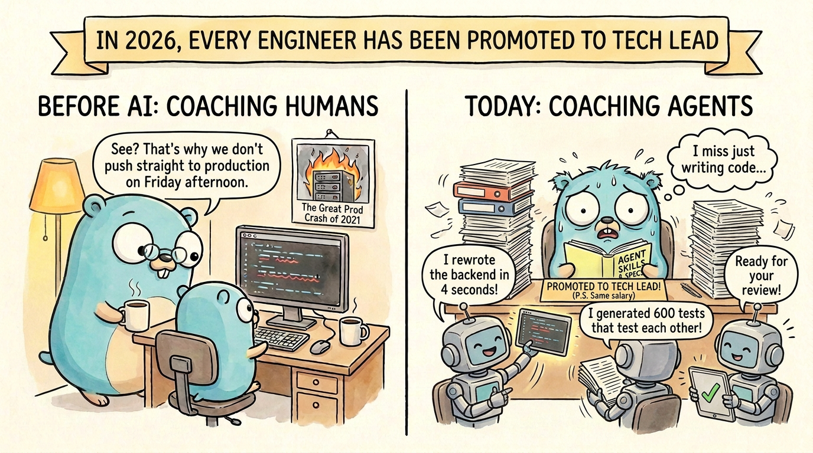

基底モデルが世界中のあらゆる知識をその重みに焼き付けたとき、人間には一体何が残されるのでしょうか？

何十年もの間、ソフトウェアエンジニアとしての私たちのアイデンティティは「コードを書く技術」そのものと結びついていました。文法を極め、標準ライブラリを記憶し、自分自身の手で組み上げたシステムに誇りを持ってきたのです。AIは単に退屈な定型コード（ボイラープレート）を片付け、毎週何時間もの自由時間を私たちに返してくれると聞かされていました。しかし現実は違いました。私たちが何年もかけて習得したものをモデルが数秒で生成する様を目の当たりにし、業界全体で深刻なアイデンティティ・クライシスが引き起こされています。機械がコードを書けるのなら、私たちはどこに居場所を見出せばよいのでしょうか？

人間は**灯台（ビーコン）**であるべきです。まさにモデルが「すべて」を知っているからこそ、モデルにとってはあらゆる道筋が同等にもっともらしく見えてしまいます。彼らには、**センス（審美眼）**を持って情報を優先順位付けし、順序立てて創造することができません。ここに私たちの新しい仕事の本質があります。まるで暗い洞窟を探検するように、私たちが懐中電灯を握り、進むべき道を照らし出し、モデルが次にどこへ集中すべきかを決定するのです。

私たちの役割は、コードの記述から「オーケストレーション（調律・指揮）」へと進化しました。実のところ、AIコーディングが登場する以前から、これは多くの人にとって目新しいことではありません。ソフトウェアエンジニアのキャリアにおける自然なステップアップそのものです。キャリアのはしごを登るにつれて、現場で直接手を動かす時間は減り、コーチとしての役割を担う機会が増えていきます。チームのアウトプットに責任を持ち、すべてのコード行に目を通すのをやめて重要な部分に集中し、仕事を他者に委ねること（デリゲーション）のメリットとデメリットに向き合うようになります。つまり、テックリードになるということです。

## 誰もがテックリードに昇格した世界

従来のキャリアパスでは、この移行は段階的に進んでいました。現場の最前線で何年も過ごし、ジュニアからシニアへと成長した後に、リードやエンジニアリングマネージャー、アーキテクトといった役職に就き、ジュニアエンジニアが実装の詳細を担当する一方で、大局的な視点に専念するようになっていました。

しかし今や、誰もがコーディングエージェントによる仮想チームを従えています。そのため、最も経験の浅いジュニアエンジニアでさえ、優れたテックリードになる方法を学ぶ必要があります。人間を率いるためではなく、エージェントを正しく導くためにです。

「何を達成するために導くのか？」これこそが最も重要な問いです。私たちが依然としてプログラムを構築していることに変わりはありませんが、それを表現する方法が変わったのです。

私の人生の中で、真に「色褪せない（エバーグリーンな）」本がいくつかあります。そのひとつが『計算機プログラムの構造と解釈』（Structure and Interpretation of Computer Programs、通称SICP）です。なぜ今、この古典が重要なのでしょうか？ それは、この本がプログラムの本質と、エンジニアが呪文を唱えてそれらを構築するプロセスを見事に言い表しているからです。

> *「計算プロセスは、コンピュータの中に棲む抽象的な存在である。プロセスは進化するにつれて、**データ**と呼ばれる別の抽象的な対象を操作する。プロセスの進化は、**プログラム**と呼ばれる規則のパターンによって指示される。人々はプロセスを指示するためにプログラムを作る。実質的に、私たちは自らの呪文によってコンピュータの精霊を召喚しているのだ。」*
>
> *「……プロセスを召喚するために私たちが使うプログラムは、魔法使いの呪文に似ている。それらは、プロセスに実行させたいタスクを規定する、秘術的かつ難解なプログラミング言語の記号表現から丹念に構成されている。」*
>
> —— ハロルド・アベルソン、ジェラルド・ジェイ・サスマン『計算機プログラムの構造と解釈』（1985年）

私たちは今でも、コンピュータに実行させたいタスクを指示するためにプロセスを召喚しています。変わったのは、呪文を紡ぎ出す言語だけです。難解な記号表現の代わりに自然な英語（日常言語）で呪文を書くようになった今、エージェントをオーケストレーションし、正しい軌道に乗せ続けることこそが仕事の最も重要な部分となりました。これは、コードを書く量が減り、コードを読む量が劇的に増えることを意味します。また、これまで以上に仕様（プロンプト）を書く機会が増えています。AI以前からテックリードを務めていた人なら、これらはすべて日常茶飯事の仕事に聞こえるはずです。

では、どうすればこのスキルを磨くことができるのでしょうか？ かつての世界では、優れたテックリードやマネージャーは、自分たちがキャリアを通じて培ってきた批判的思考やセンスをチームに身につけさせるため、コーチングやメンタリングに多くの時間を費やしていました。数々の現場の傷跡（トラブル対応）から得られたプロセス、行動規範、テクニックの知識を少しずつ伝授していったのです。先ほど私が行った重箱の隅をつつくような厳格なコードレビューですか？ それは、何年も前に私自身の細部への不注意が原因で本番環境をダウンさせてしまった苦い経験があるからに他なりません。

現代の世界では、人間のメンターや自らの失敗から学ぶだけでなく、エージェントの振る舞いを注意深く観察し、**彼らの**過ちから学ぶ必要があります。それらの失敗は猛烈な速度で蓄積されるため、エージェントは究極の「圧縮されたフィードバックループ」を提供してくれます。午後の一握りの時間の中で、何十もの微妙な障害モード、競合状態、ハルシネーション（幻覚）による設計破綻が目の前で次々と展開され、従来のリリースサイクルの10倍の速さでアーキテクチャの審美眼を鍛え上げることができるのです。

本質的に、私たちの現在の仕事は「情報の流れをオーケストレーションすること」であり、エージェントが私たちが望む成果物を生み出すための最適な環境を常に整えることです。

私たちが目の当たりにしている進化のスピードを考えると、今日最適なものが明日も最適であるとは限りません。進化のペースに遅れないよう、私たちはツールやプロセスを絶えず洗練させていく必要があります。かつてないほど、ソフトウェアは「使い捨て」の時代に入りました。明日にはまた新しい呪文が必要になるからこそ、私たちの呪文は迅速かつ的確でなければならないのです。

## モデルが自律的に行動できるよう情報を構造化する

> *「熟練したソフトウェアエンジニアは、結果として生じるプロセスが意図したタスクを実行することを合理的に確信できるように、プログラムを体系化する能力を備えている。彼らは自分たちのシステムの挙動を事前に視覚化できる。予期せぬ問題が破滅的な結果につながらないようにプログラムを構造化する方法を知っており、問題が発生したときにはプログラムを**デバッグ**できる。優れた設計の計算システムは、優れた自動車や原子炉と同様に、部品ごとに独立して構築、交換、デバッグできるようにモジュール構造で設計されている。」*
>
> —— ハロルド・アベルソン、ジェラルド・ジェイ・サスマン『計算機プログラムの構造と解釈』（1985年）

上記の引用文の「プログラム」という言葉を「エージェント」に置き換えてみてください。その構造はそのまま通用します。私たちは、優れた計算システムを生み出せるように、エージェントを活用したコーディングプロセスを体系化する方法を学ぶ必要があります。

エージェントに知識を与える最も重要な方法のひとつが、[Agent Skills]()を通じたアプローチです。モデルは人間に極めて近い振る舞いをします（人間が生成したデータで訓練されている以上、当然のことです）。そのため、私たちがチームの生産性や成果物の品質を高めるために適用してきた手法は、そのままエージェントにも応用できます。自身の現場経験やノウハウ、業界のベストプラクティスに基づき、モデルの挙動を的確に導くスキルを作成する絶好の環境が整っているのです。

そうした手法のひとつが、複雑なタスクを小さく分割することです。アジャイル開発の根幹をなすこの考え方は、仕様駆動開発（spec-driven development）、実装計画、そして[サブエージェント]()という枠組みを通じてエージェントコーディングにもそのまま適用できます。

私自身は、サブエージェントを「設計する情報フローの構成要素」として扱っています。これは多くの意味で従来の並行処理（concurrency）の扱いに似ていますが、コンテキストを隔離する上でも極めて重要な役割を果たします。結局のところ、モデルに必要なのは「適切なアテンション（注意）」だけなのです。タスクを互いに独立した直交的な単位に分割し、個々のサブエージェントに処理させることで、エージェントの貴重なアテンションを単一のタスクだけに集中させ、品質と仕様遵守率を飛躍的に向上させることができます。

ワークフローを手動で組み立てる際や、後世に残るスキルを構築する際には、特に以下の点が役に立ちます。

1. **コーディネーターの役割**: コーディネーター（親セッション）が常にサブエージェントへ作業を委譲し、メインセッションを可能な限り迅速に解放することが重要です。これにより、サブエージェントが作業を進めている間もユーザーは対話を継続でき、リアルタイムに指示やコメントを与えて軌道修正できます。
2. **タスクの直交性**: タスク間の依存関係や競合を最小限に抑えるため、互いに独立した単位に切り分けます。まず順序依存を理解し尊重した上で、サブエージェント同士が互いの作業を上書きしたり矛盾した仮定を置いたりしないよう、確信を持って並列化します。
3. **実績あるパターンの再現**: コーチングやメンタリングと同様に、人間のチームや従来のソフトウェア工学で機能してきたパターンはエージェントにも有効です。文献に立ち返り、エージェントに伝授できる新旧のパターンを継続的に探求してください。

私は過去数ヶ月にわたり、自らの[スキルカタログ（skill catalog）](https://skills.danicat.dev)を段階的に構築してきました。モデルやエージェント実行環境の進化に伴い、スキルは急速に*腐敗*するため、一度作れば終わりというものではありません。私はそれらを絶えずアップデートしており、陳腐化しつつあるスキルを可視化して改修するか除外するかを判断できるよう、スキルに「鮮度スコア」を付与することにしました。

日々の開発で私が頻繁に活用しているスキルの例をいくつか挙げます。

- **`double-diamond`**: アジャイルのダブルダイヤモンド手法に基づき、実装前に必ず課題発見と要件定義を強制するプロダクト開発ワークフロー。
- **`parallel`**: タスクを複数のスレッドに展開（ファンアウト）し、最後に結果を照合（マップリデュース）する汎用並行処理パターン。
- **`uno-reverse`**: モデルの過信や過剰エンジニアリング（オーバーエンジニアリング）の傾向を是正するための敵対的レビュー（アドバーサリアルレビュー）。
- **`less-is-more`**: 肥大化したアプリを作るのを防ぎ、一度にひとつのことを完璧に行うよう指示する設計哲学。
- **`intercom`**: 関連するプロジェクトで作業している複数のエージェント同士が自律的に対話できるようにする連携スキル。
- **`show-me-the-money`**: モデルと議論したものの完全に実装を忘れていた機能のアイデアを、会話履歴から発掘するスキル。
- **`abstract`**: 哲学的な原則を用い、個別の事例や状況を抽象化して汎用的な知識へと昇華させるスキル。

## エージェントコードにおける「割れ窓理論」

> *「正常に動作するコンピュータにおいて、計算プロセスはプログラムを正確無比に実行する。したがって、魔法使いの弟子のように、初心者のプログラマは自らが召喚したものの結果を理解し、予期することを学ばなければならない。プログラム内の小さな誤り（通常**バグ**や**グリッチ**と呼ばれる）であっても、複雑で予期せぬ結果を引き起こす可能性がある。……しかし、現実世界のプログラミングには、細心の注意、専門知識、そして知恵が求められる。」*
>
> —— ハロルド・アベルソン、ジェラルド・ジェイ・サスマン『計算機プログラムの構造と解釈』（1985年）

魔法使いの弟子と同じように、私たちが呼び出したものの結果を予期できなければ、手綱を握られていないエージェントは猛烈な速度で指示を実行し、私たちが気付く前に小さな構造的欠陥を無数に増殖させてしまいます。この問題は何も新しいものではありません。人間が書いたコードでも常に起きていたことですが、以前は進行がはるかに緩やかだったため目立たなかっただけです。かつてそれを止めようとした人たちは、決まって「重箱の隅をつつく偏屈なレビュアー」と見なされ、ごく一部から愛される一方で大半からは煙たがられていました。

心理学では、これは1969年の実験に端を発する「割れ窓理論（Broken Windows Theory）」として知られる現象です。研究者たちが治安の良い住宅街に放置車両を1週間置いたところ、車には何の異変も起きませんでした。2週目に研究者のひとりがスレッジハンマーで窓ガラスを1枚叩き割ったところ、わずか数時間のうちに車は解体され、部品をすべて持ち去られてしまいました。

割れたガラスが引き金だったのです。それは「誰も気にしていない」というシグナルとなり、コミュニティ全体が一斉に配慮をやめてしまいました。私は何年もの間、コードでも全く同じことが起きると主張し続けてきました。

コードの中にひとつの割れ窓（例えばタイポ、不適切な命名、脆弱なテスト、誤った抽象化など）が生じると、私たちの心理的な関心低下スイッチが入ってしまいます。そして問題は時間の経過とともに雪だるま式に悪化し、小さな欠陥が巨大な崩壊へと膨れ上がります。

エージェントの世界では、既存のコードが新しいコードを生成する際のバイアスとなるため、この問題はさらに増幅されます。既存のコードが粗悪な場合、適切に指示しない限り、エージェントはそれを「許容される標準」と判断し、問題を加速度的に悪化させていきます。

コードレビューはエンジニアリング業務の中で決して派手な作業ではなく、エンジニアの中には仕事の一部と見なさない人さえいます。しかし実際には、最も重要な業務のひとつです。

ただし、これは**すべてのコード行を一行ずつ精査する**という意味ではありません。

私を含め、AIが生成した何千行ものコードを延々とレビューしたい人などいません。審美眼（センス）とは、構文をチェックしたり機械的なバグを見つけたりすることではありません。それは決定論的ツールが担うべき領域です。私が『[エージェント時代におけるコードレビューのやり方]()』で書いたように、コンパイラ、リンター、自動テストで検出できる問題なら、人間がいちいち目を凝らすべきではないのです。

私たちは「AIにはAIと自動化で対抗する」必要があります。決定論的な品質ゲートを用いて機械的なノイズを排除し、レビューの時間を重要なアーキテクチャ境界の検証に集中させ、残りはサンプリング検査に留めます。現代の開発サイクルは従来の「手作りの職人芸的コーディング」よりも何倍も高速であるため、サンプリングによって万が一問題を即座に拾えなかったとしても、すぐに次の機会で捉えることができます。したがって、レビューは真にクリティカルな要所に絞り込み、残りは自動化されたプロセスを信頼して委ねるべきです。

## 約束された「自由時間」はどこへ消えたのか

私たちはかつてない速度でソフトウェアを構築しています。実装のボトルネックが解消されたことで、より緊急性の高いタスクに押し出されてお蔵入りしていた数々のアイデアが、一気に実現可能になりました。放棄されたプロジェクトの山に埋もれる前に、何が機能し何が機能しないかを確かめるためのプロトタイプを次々と迅速に生み出せるようになったのです。

しかし、開発が加速したからといって、メンタルモデル（概念の体系化）を構築する必要性が消えるわけではありません。私たちのコア業務は、エージェントが私たちが真に意図したものを構築できるよう、コンテキスト、制約、そしてフィードバックループを設計することです。むしろ、私たちの仕事は以前より難しくなりました。技術的な知識自体はコモディティ化しましたが、それらを束ねるセンスや批判的思考力はいまだ希少なままだからです。

結局のところ、私たちは今もコンピュータの精霊を召喚する魔法使いであり続けています。ただ、私たちの呪文がまたひとつ上の抽象化レイヤーへと到達しただけに過ぎないのです。
